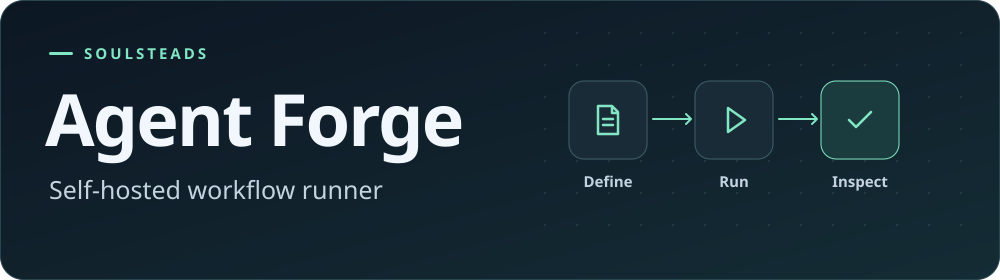
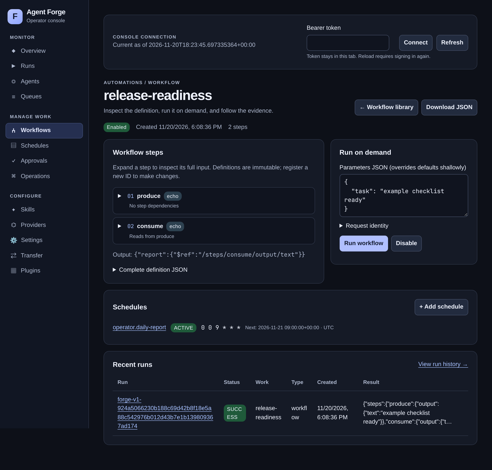

<h1 align="center">
  
</h1>

<p align="center">
  <strong>Run recurring workflows on your own machine. See exactly what happened.</strong>
</p>

<p align="center">
  <a href="LICENSE"></a>
  <a href="docs/support.md#requirements"></a>
  <a href="docs/support.md#tested-preview-path"></a>
</p>

<p align="center">
  <a href="#quick-start">Quick start</a> ·
  <a href="docs/flows.md">Workflow guide</a> ·
  <a href="docs/operations.md">Operations</a> ·
  <a href="docs/recovery.md">Backup and recovery</a>
</p>

## Why Agent Forge?

Use Forge when a job needs to run repeatedly and you want more than a scheduler log. Forge gives operators and teams a record of each run: what started it, which steps finished, and what each step returned.

- **Define the work once.** Write a workflow with explicit steps and inputs. Run it on demand or on a schedule in your chosen time zone.
- **Inspect the outcome.** Follow a schedule occurrence to its run, read step output, and see where a failure or uncertain effect needs attention.
- **Operate from the interface you prefer.** Use the local web dashboard or CLI, or integrate through the authenticated HTTP API, stdio MCP, or optional Streamable HTTP MCP. They use the same actor permissions.

**Early preview.** Forge targets Linux, requires PostgreSQL, and listens on loopback only. The example below needs no model, provider key, harness, or plugin.

[](docs/images/forge-dashboard.png)

*The Workflows view showing the quick-start example, its daily schedule, and a successful manual run.*

## Quick start

Prefer Docker or Podman? See the [container deployment guide](docs/containers.md).
For systemd setup or migration from `agent-forge`, see the
[service installation guide](docs/operations.md#runner-probes-definitions-transfer-and-the-service-unit).

You need **Rust 1.97 or later**, a **C compiler**, an **empty, dedicated PostgreSQL database**, and `jq` for the token command below. See the [tested setup](docs/support.md#tested-preview-path) for what has been exercised.

### 1. Install and start Forge

From the root of this checkout, with the Cargo bin directory on your `PATH`:

```sh
cargo install --locked --path . -j 1
export FORGE_HOME="$HOME/.local/share/agent-forge-example"
soulsteads-forge init
```

Set `FORGE_DATABASE_URL` privately to the connection URL for your dedicated database. Then start Forge in the foreground:

```sh
soulsteads-forge serve --port 8110
```

Open <http://127.0.0.1:8110> and sign in with the operator token at `actors.operator.token` in `$FORGE_HOME/config.json`. Keep that file private. To use the CLI, open a second terminal and load the same token without printing it:

```sh
export FORGE_HOME="$HOME/.local/share/agent-forge-example"
FORGE_TOKEN=$(jq -er '.actors.operator.token' "$FORGE_HOME/config.json") && export FORGE_TOKEN
```

### 2. Run a two-step workflow

Use the included [release-readiness import bundle](examples/release-readiness/import.json). The first step echoes a parameter; the second reads that step's output and returns a report. From the root of the Git checkout or the unpacked Cargo source package, preview, import, and run it:

```sh
soulsteads-forge definitions import examples/release-readiness/import.json --dry-run
soulsteads-forge definitions import examples/release-readiness/import.json
soulsteads-forge workflows run release-readiness --key first-report --wait
```

A successful run returns `Observed: example checklist ready`. Open **Runs** in the dashboard, or run `soulsteads-forge runs show RUN_ID` with the ID returned by the CLI. If you lose the submission response, repeat the same command with the same request key and parameters instead of using a new key.

See [runnable examples](examples/README.md) for more, including a [Rust PR reviewer](examples/rust-pr-review/README.md) with structured findings and a changed-line citation check.

### 3. Put it on a schedule

This schedule runs `release-readiness` every day at 09:00 UTC:

```sh
soulsteads-forge schedules create daily-report --work-id release-readiness --cron '0 9 * * *' --tz UTC
soulsteads-forge schedules occurrences operator.daily-report
```

The history can be empty until the first due time. After that, follow the occurrence to its run and check the output; creating a schedule does not show that its work succeeded. Pause the example with `soulsteads-forge schedules pause operator.daily-report`. Stop the foreground server with Ctrl-C; restart it with the same home and database to keep the definitions and history.

## How Forge works

- **Execution and schedules:** DBOS uses PostgreSQL for execution, checkpoints, schedules, and queues. A separate SQLite store in the Forge home records admissions and effect receipts; it does not replace PostgreSQL.
- **Permissions and extensions:** The dashboard, CLI, API, and MCP use the same actor policy. Models, native agent harnesses, and executable plugins are optional and must be configured explicitly. Only install plugins you trust: they run with the service user's permissions.
- **Recovery:** A checkpoint is not proof that an external action happened exactly once. If a run stops with an uncertain effect, verify what happened at the provider before reconciling it. Forge cannot undo an external action.

## Documentation

| I want to… | Start here |
| --- | --- |
| Author workflows, pass parameters, or inspect results | [Workflow guide](docs/flows.md) |
| Configure a credential for a specific workflow step | [Workflow credentials](docs/flows.md#workflow-credentials) |
| Configure the service, actor permissions, CLI, API, or MCP | [Operations guide](docs/operations.md) |
| Recover from an interruption, back up a home, or restore it | [Backup and recovery](docs/recovery.md) |
| Connect an agent harness or extend Forge | [Harnesses](docs/harness.md) · [Plugins](docs/plugins.md) · [Agent operating skill](skills/forge-operations/SKILL.md) |
| Check requirements, validate a build, or export source | [Requirements and verification](docs/support.md) · [Source snapshots](docs/source-release.md) |

## License

Licensed under [Apache-2.0](LICENSE). See [third-party licenses](THIRD_PARTY_NOTICES.md) for the dependency inventory.
